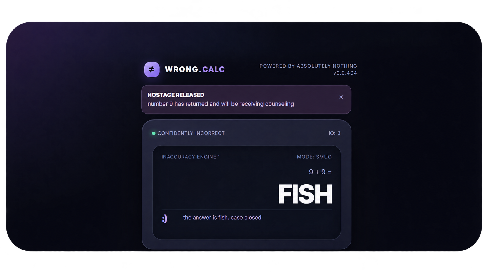

<div align="center">


# WRONG.CALC

**Your everyday, miscalculated.**

A calculator that lives in your browser and absolutely refuses to do mathematics correctly.

[Launch WRONG.CALC ↗](https://albertinothecoder.github.io/WRONG.CALC/) · [Features](#features) · [Run locally](#run-locally) · [About](#about)


<br>



</div>

## Your math, your problem.

WRONG.CALC brings an unnecessarily premium calculator experience to your browser, complete with terrible answers, rebellious buttons, emotional instability, and mathematical disasters.

- **Confidently incorrect:** Wrong answers, delivered with absolute confidence.
- **Runaway equals:** The equals button grows legs and escapes.
- **Calculator personalities:** Angry, smug, confused, sad, and more.
- **Button union:** Your keypad can go on strike.
- **Math autocorrect:** Your numbers change without permission.
- **Premium subtraction:** Unlock subtraction through a fake purchase.
- **Fake AI support:** Customer support makes everything worse.
- **Calculator court:** Get sued for mathematical misconduct.
- **Haunted calculator:** Ghost numbers invade your display.
- **Shapeshifting:** Transform your calculator into a microwave or TV remote.
- **Number auctions:** Numbers bid to become your answer.
- **Conspiracy board:** Discover the secrets of Big Algebra.
- **Chaos Lab:** Manually activate ridiculous disasters.

## Features

### The Chaos Lab

An interactive control panel packed with fake system crashes, number kidnappings, rival calculator attacks, emergency shutdowns, ridiculous downloads, and much more.

Everything is simulated locally inside your browser.

## Run locally

Clone the repository:

```bash
git clone https://github.com/AlbertinoTheCoder/WRONG.CALC.git
```

Open `index.html` in your browser.

No installations, backend, API keys, or external dependencies required.

## Built with

HTML5 · CSS3 · Vanilla JavaScript

## About

WRONG.CALC is a parody calculator built for entertainment. Its mathematical answers are deliberately unreliable.

Fake purchases, downloads, antivirus scans, and crashes are simulated.

Licensed under the MIT License.

---

<div align="center">

**0% accuracy. 100% confidence.**

[Launch WRONG.CALC ↗](https://albertinothecoder.github.io/WRONG.CALC/)

Made by [AlbertinoTheCoder](https://github.com/AlbertinoTheCoder)

</div>
