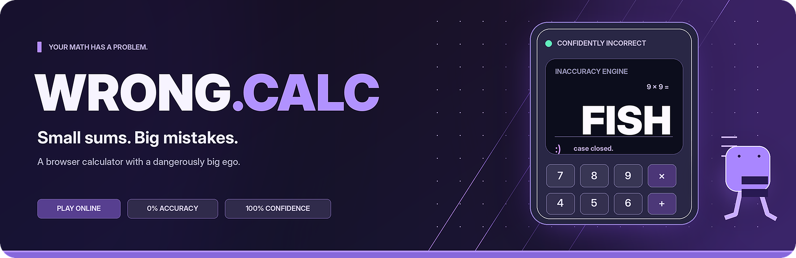

<div align="center">

<a href="https://albertinothecoder.github.io/WRONG.CALC/">
  
</a>

<br>

[](https://albertinothecoder.github.io/WRONG.CALC/)


### A calculator with an enormous ego and absolutely no qualifications.

Bad at math. Worse at taking criticism. Occasionally runs away on tiny legs.

[**Launch WRONG.CALC**](https://albertinothecoder.github.io/WRONG.CALC/) · [**The chaos**](#the-chaos) · [**Run locally**](#run-locally) · [**Source code**](https://github.com/AlbertinoTheCoder/WRONG.CALC)

</div>

---

## The chaos

WRONG.CALC is a deliberately terrible, fully interactive calculator. It looks premium, produces questionable answers, and gets increasingly upset when you ask it to do its only job.

| The feature | The disaster |
| :--- | :--- |
| **Wrong answers** | 0% accuracy, 100% confidence |
| **Runaway equals** | The equals button grows legs and escapes for 10 seconds |
| **Button union** | The keypad goes on strike |
| **Math autocorrect** | Your numbers are corrected against your will |
| **Calculator court** | You get sued for emotional damage |
| **Haunted calculator** | Ghost numbers invade the display |
| **Premium subtraction** | Subtraction requires a pretend, free purchase |
| **Shapeshifting** | The calculator becomes a microwave or TV remote |
| **Chaos Lab** | Trigger fake crashes, number auctions, ransom demands, and more |

## Try it

No setup required. **[Play in your browser](https://albertinothecoder.github.io/WRONG.CALC/)**.

The app is intentionally unreliable, but the chaos is real (inside the webpage, anyway).

## Run locally

```bash
git clone https://github.com/AlbertinoTheCoder/WRONG.CALC.git
```

Open `index.html` in your browser. No packages, backend, account, or API key needed.

## About

Built with **HTML, CSS, and vanilla JavaScript**. This is a parody project made for entertainment, not a tool for real calculations. All purchases, system errors, scans, and downloads are simulated. Licensed under the MIT License.

<div align="center">

**THE CALCULATOR IS NEVER WRONG. YOU ARE.**

[Play online](https://albertinothecoder.github.io/WRONG.CALC/) · [Made by AlbertinoTheCoder](https://github.com/AlbertinoTheCoder)

</div>
