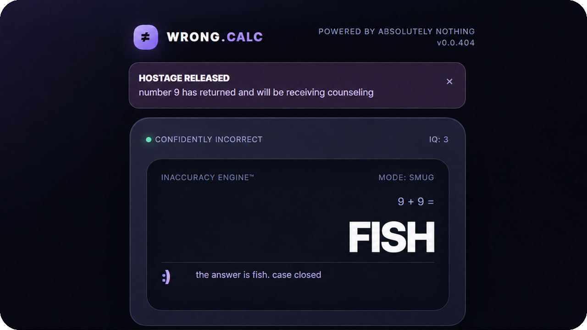

<div align="center">


<h1>WRONG.CALC</h1>



**Your everyday, miscalculated.**

A calculator that lives in your browser and absolutely refuses to do math correctly.

[**Launch WRONG.CALC ↗**](https://albertinothecoder.github.io/WRONG.CALC/) · [Features](#features) · [Run locally](#run-locally) · [About](#about)

    

</div>

## Features

WRONG.CALC looks like a serious calculator. It isn't.

- **Confidently incorrect** — Wrong answers delivered with zero hesitation.
- **Runaway equals** — The equals button grows legs and runs for 10 seconds.
- **Bad attitude** — Anger, mood swings, insults, and fake AI confidence.
- **Math autocorrect** — Your numbers get changed without permission.
- **Button union** — The keypad goes on strike.
- **Haunted calculator** — Ghost numbers appear in the display.
- **Fake premium math** — Unlock subtraction with a free pretend purchase.
- **Calculator court & support** — Get sued, then receive terrible customer service.
- **Shapeshifting** — Your calculator turns into a microwave or TV remote.
- **Number chaos** — Kidnappings, auctions, conspiracies, and more.

## Chaos Lab

Trigger fake crashes, pirate your own cursor, imprison numbers, summon a rival calculator, or watch the equals button escape. Everything is just for fun and stays inside the browser.

## Run locally

Clone this repository:

```bash
git clone https://github.com/AlbertinoTheCoder/WRONG.CALC.git
```

Open `index.html` in your browser. No installation, account, or API key required.

## About

Built with **HTML, CSS, and vanilla JavaScript**. WRONG.CALC is a parody, not a real math tool. Fake purchases, downloads, and system crashes are simulated.

Licensed under the [MIT License](LICENSE).

<div align="center">

**0% accuracy. 100% confidence.**

[**Play WRONG.CALC ↗**](https://albertinothecoder.github.io/WRONG.CALC/) · Made by [AlbertinoTheCoder](https://github.com/AlbertinoTheCoder)

</div>
