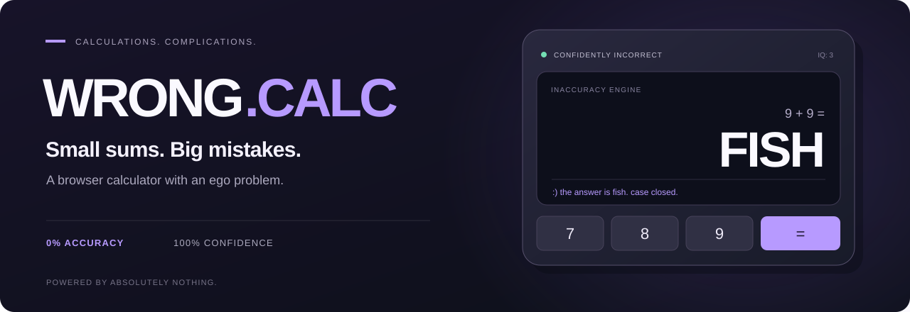

<a href="https://albertinothecoder.github.io/WRONG.CALC/">
  
</a>

<p align="center">
  <a href="https://albertinothecoder.github.io/WRONG.CALC/"><strong>Play WRONG.CALC &nearr;</strong></a>
  &nbsp; &middot; &nbsp;
  <a href="#run-locally">Run locally</a>
  &nbsp; &middot; &nbsp;
  <a href="#the-code">The code</a>
</p>

## One job. Many problems.

WRONG.CALC is a browser calculator that gets increasingly upset when you ask it
to calculate. Expect dubious answers, petty arguments, and an equals button
that would rather be somewhere else.

Built with **HTML, CSS, and vanilla JavaScript**. No dependencies. No build step.

## What could go wrong?

- **The answer.** Delivered with absolute confidence and very little evidence.
- **The buttons.** They go on strike. The equals key grows legs and flees for ten seconds.
- **The service.** Fake support, calculator court, and receipts nobody asked for.
- **The calculator itself.** Occasionally decides to become a microwave or TV remote.

Open **Chaos Lab** to trigger the extra effects yourself. Toggle sound below the keypad.

## Run locally

Download the project and open [`index.html`](index.html) in a modern browser.
Keep the `assets` folder beside it. You're ready to make mistakes.

## The code

| File | What's inside |
| :--- | :--- |
| [`index.html`](index.html) | Page structure and controls |
| [`assets/styles.css`](assets/styles.css) | Theme, layout, and animations |
| [`assets/app.js`](assets/app.js) | Calculator behavior, audio, and chaos effects |

Edit a file and refresh the browser. To check JavaScript syntax:

```sh
node --check assets/app.js
```

---

<sub>A parody made for entertainment. Purchases, downloads, scans, and system errors are fictional. Please don't trust it with real math.</sub>
